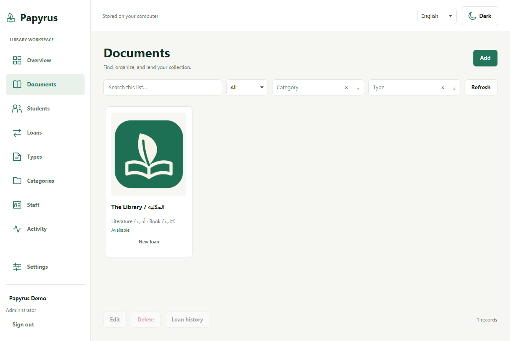
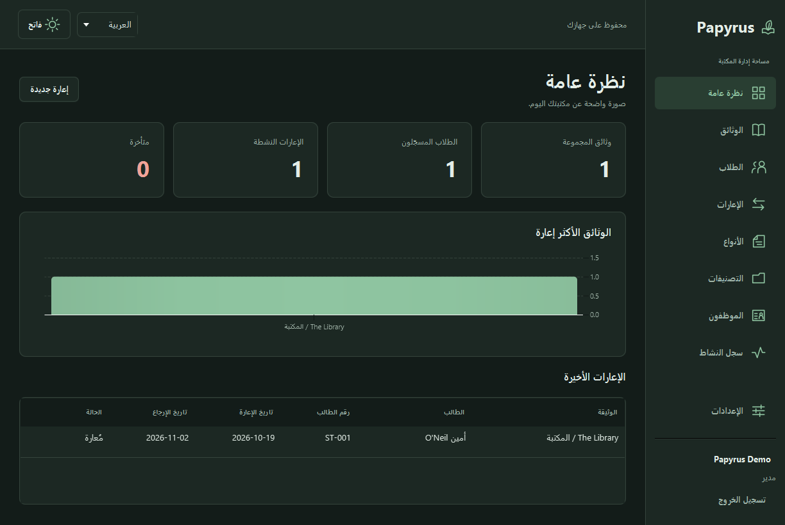
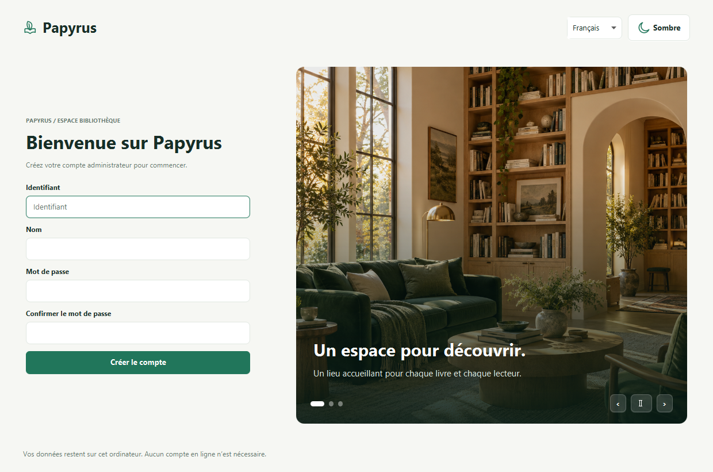

# Papyrus

A desktop library manager built with JavaFX and SQLite. Available in **French, English, and Arabic**, with light and dark themes and a right-to-left Arabic layout.

Manage documents with a scrollable cover gallery, students, loans, staff, categories, and document types. The overview shows actual collection and loan totals; document, student, and staff histories retain previous loans. Administrators can manage accounts and inspect the activity log.





## Install

Download the Windows or Linux x64 package from [Releases](https://github.com/ayoub-ghanaj/papyrus/releases). Packages include the Java runtime; users do not need to install Java or Maven.

| System | Installer | Portable version |
| --- | --- | --- |
| Windows 10/11 x64 | Run the `.exe`; choose the installation folder and shortcuts. | Extract the ZIP and open `Papyrus/Papyrus.exe`. |
| Ubuntu/Debian x64 | Install the `.deb` with your package manager, or `sudo apt install ./Papyrus-1.1.0-linux-x64.deb`. | Extract the `.tar.gz` and run `Papyrus/bin/Papyrus`. GTK 3 and a graphical desktop are required. |

On first launch, create an administrator account. There is no default password. Existing installations keep their existing sign-in details.

The packages are unsigned; Windows may show a publisher warning. Release downloads include SHA-256 checksums. macOS and ARM builds are outside this release's scope.

## Everyday use



- The login screen cycles through three local library images. Use its pause and navigation controls to control the slideshow.
- Switch language and appearance using the controls at the top of the window. Both settings are saved.
- Add documents with optional covers, authors, ISBNs, shelf locations, and copy/barcode identifiers. Create a missing category or type directly in the form. Filter the gallery by these details, category, type, and availability.
- Type in document, student, category, and type selectors to see matching suggestions. Find students by ID, name, phone, or email; use the arrow keys and Enter to choose a result. French accents and Arabic diacritics are handled during search.
- Register a student, then create a loan from the gallery or Loans screen. The return date must be after today.
- Renew an active loan to extend its due date. Mark it returned to record the return time and make the document available again. Use the overdue filter, export the visible list, or print an overdue report. Include returned loans to see history.
- Double-click a document card or a student/staff row to edit it. Select a record for its history or deletion actions.
- Return outstanding loans before archiving their document or student. Use **Archived records** on each list to restore the original record and its history. For an archived document, restore its category and type first.
- Staff account management, the activity screen, and full backup/restore are restricted to administrators. The last administrator and your own account are protected against deletion or role changes. Role changes, account deletion, and password resets invalidate existing sessions on their next operation. Change your own password in Settings.
- Search and filter selections survive edits and refreshes. If another window changes a record while you edit it, reopen the editor before saving.
- Use the CSV template to import documents or students. Imports add new records and create missing category/type names; a validation error cancels the entire import and identifies the failing record. Export includes all active records; loan export includes only the visible list. Templates use fixed English headers, UTF-8, and standard CSV quoting. Imports accept up to 5,000 records and 10 MB. Spreadsheet formula-like values are escaped on export and decoded when reimported.

## Data and upgrades

Everything is stored locally. The default data folder is:

| System | Folder |
| --- | --- |
| Windows | `%APPDATA%\Papyrus` |
| Linux | `$XDG_DATA_HOME/papyrus`, or `~/.local/share/papyrus` |

The folder contains `test1.db`, imported images in `images/`, and `settings.properties`. Administrators can use **Settings → Create backup** to save a verified ZIP containing accounts, records, and referenced images. Keep backups private. **Restore backup** validates the archive and first saves the current library under `backups/`; other Papyrus windows using that library must be closed. After restoration, sign in with an account from the restored backup. Language and appearance preferences remain local to the current installation. Archives support up to 2 GB of expanded content and 25,000 entries. Missing source images must be repaired before a complete backup can be made.

You can also close Papyrus and copy the **entire folder**. Imported image references are relative to this folder, and old absolute references to managed images are resolved from the copied `images/` folder when available. Uninstalling preserves the data folder.

The original application's tables and IDs are retained. Before using an old database, back up its database **and original image files**. You can copy `test1.db` into the default data folder, or launch from the original project folder containing `database/test1.db`; Papyrus recognizes that legacy location. For a custom location, pass `-Dpapyrus.dataDir=/absolute/data/folder` to Java when running from source.

Close all running Papyrus windows before upgrading. Opening a 1.0.x library in 1.1.0 first creates `test1.pre-1.1.0.db`, then adds metadata, session versions, return/renewal fields, and indexes in a transaction. IDs and history are retained. These automatic migration snapshots contain the database only. Keep a full backup including images and use Papyrus 1.1.0 or later after migration.

The first opening of a legacy database creates `test1.pre-1.0.0.db` as a database-only backup before initializing missing tables or upgrading passwords. Old cleartext passwords are upgraded to salted PBKDF2 hashes on successful login. Keep image files at their existing locations, or reselect them in the editor to import a copy into the new data folder. The original repository's `resources/img/` is retained for legacy file references and is not bundled into installers.

## Build and run

Install JDK 25. The Maven wrapper downloads Maven 3.10.0 on first use.

```sh
./mvnw clean verify
./mvnw javafx:run
```

On Windows, use `mvnw.cmd` in place of `./mvnw`. The build pins JavaFX 27 and SQLite JDBC 3.53.4.0. IDEs can import `pom.xml` directly.

The test suite checks persistence, migrations, Unicode, permission revocation, atomic sign-in, password changes, loan renewal/return, archive restoration, edit conflicts, portable backups, unsafe archives, atomic CSV import, and translation coverage. To exercise the actual UI on a graphical desktop after building:

```sh
java --enable-native-access=ALL-UNNAMED -cp 'target/test-classes:target/classes:target/lib/*' papyrus.UiSmoke
java --enable-native-access=ALL-UNNAMED -cp 'target/test-classes:target/classes:target/lib/*' papyrus.UiReliabilitySmoke
```

Use `;` instead of `:` in the class path on Windows. The UI exercise uses a separate temporary database and writes screenshots under `target/screenshots/`. On a display without a window manager, add `-Dpapyrus.smoke.skipWindowManager=true` to skip native maximize/fullscreen checks.

## Build installers

Run the following on each target operating system with JDK 25 and Python 3.11+:

```sh
python scripts/package.py
```

Windows needs WiX Toolset 3.14.1 or another version supported by JDK 25 `jpackage`. Debian packaging needs `fakeroot` and `dpkg-deb`. The script builds a trimmed Java runtime, a native installer, a portable archive, and checksums under `dist/`. `--portable-only` skips installer tooling. Neither package includes local databases, demo accounts, or the original repository's photos.

GitHub Actions builds and tests Windows and Linux packages. On disposable runners it installs the checksum-pinned 1.0.0 release, creates a temporary library, upgrades to the candidate installer, verifies data and images, then checks that uninstall preserves the library. `scripts/installer-smoke.py` refuses to run outside GitHub Actions. The desktop checks cover a 600-document gallery, retained filters, metadata editing, printable reports, and account controls at a 960×680 window size. Tags matching `v*` prepare a **draft** GitHub release after both platform builds pass. Review the draft and installers before publishing. `scripts/check-release.py` requires the tag, `pom.xml`, release notes, and UI version labels to agree. An existing release is never overwritten by the draft workflow. Dependabot updates are grouped; repository security alerts, security updates, secret scanning, and push protection are enabled.

The project uses JavaFX, SQLite JDBC, SLF4J, and a Java runtime. See [THIRD_PARTY.md](THIRD_PARTY.md) for component notices.
